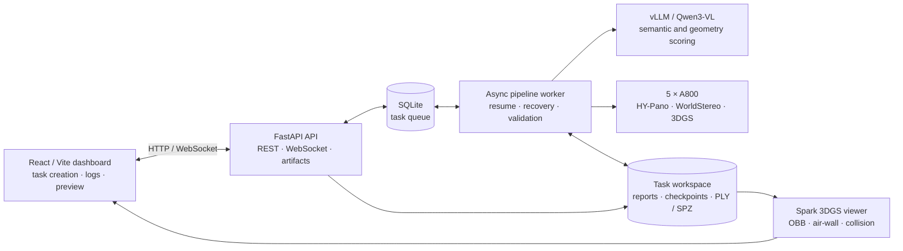
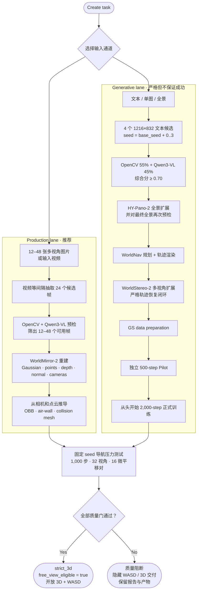
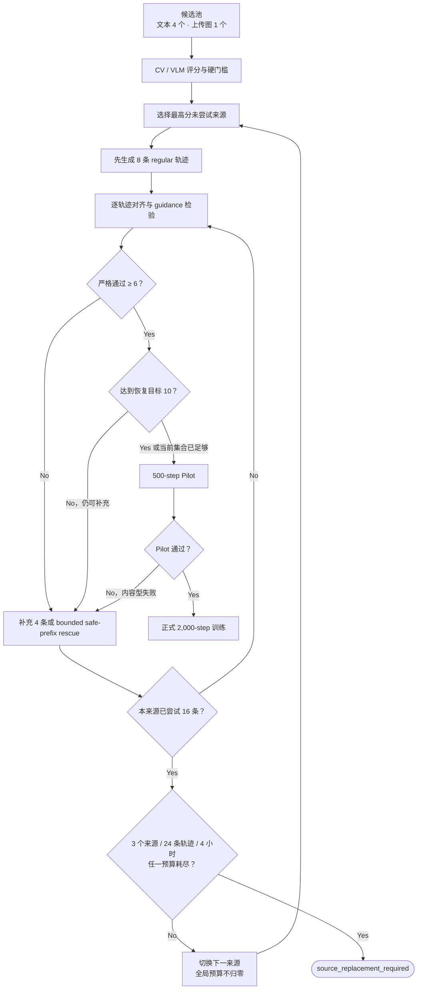
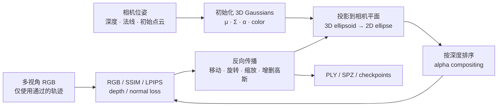
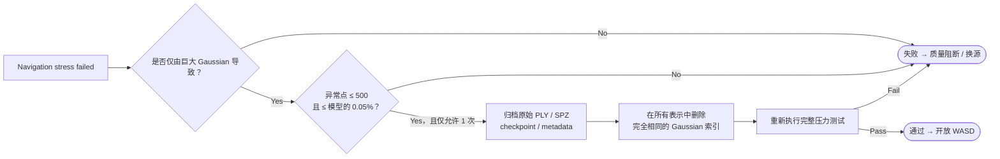
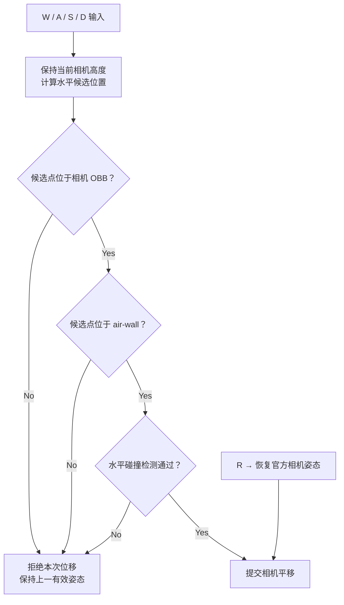
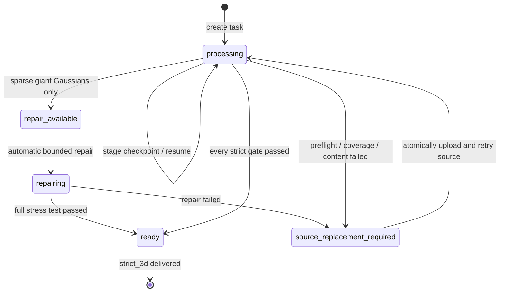

<div align="center">

# GSStudio

### Strict free-view 3D world generation and multi-view reconstruction

将文本、单图、全景、多视角图片或视频转换为**经过质量审计、可安全 WASD 浏览的静态 3D Gaussian Splatting 场景**。

[](#)
[](#quality-gates)
[](#strict-delivery-contract)
[](#system-architecture)
[](server)
[](web)
[](#browser-viewer)
[](#license)

[在线 POC](#live-poc) · [为什么是 GSStudio](#why-gsstudio) · [完整流程](#end-to-end-pipeline) · [3DGS 原理](#how-3dgs-works) · [质量门](#quality-gates) · [快速开始](#quick-start) · [API](docs/api.md) · [系统设计](docs/design.md)

</div>

> [!IMPORTANT]
> GSStudio 不把锚点式、降级式或只能旋转查看的产物包装成自由视角模型。只有输入、几何覆盖、训练质量、产物一致性和导航压力测试全部通过，系统才会写入 `free_view_eligible=true` 并开放 WASD。

---

<a id="why-gsstudio"></a>

## Why GSStudio

普通的“任务完成”只说明程序跑到了结尾，不代表模型能稳定自由移动。GSStudio 在 [HY-World 2.0](https://github.com/Tencent-Hunyuan/HY-World-2.0) 之外增加了一层面向交付的闭环：先判断输入是否适合三维重建，再验证相机是否真的发生平移，最后从浏览器用户的移动范围反向测试模型。

| 能力 | GSStudio 的处理方式 | 交付结果 |
| --- | --- | --- |
| 生产级多视角 / 视频 | 先做分辨率、清晰度、特征、匹配和非纯旋转视差预检 | 推荐通道，适合稳定生产 |
| 文本 / 单图 / 全景 | 多候选生成、视觉评分、逐源恢复和有界预算 | 严格但不承诺任意输入必成 |
| 3DGS 训练 | Pilot 与正式训练隔离，拒绝轨迹不进入训练 | 避免用坏数据“硬训”出伪 3D |
| 浏览器漫游 | OBB、air-wall、碰撞网格和官方姿态复位 | 仅在验证范围内开放 WASD |
| 失败处理 | 保留候选、日志、报告和已有产物 | 给出可诊断原因，不伪装成功 |

<a id="strict-delivery-contract"></a>

### Strict delivery contract

```text
completed + artifacts != free-view delivery

free-view delivery = input preflight
                   + real translated camera coverage
                   + pilot/final quality validation
                   + finite synchronized artifacts
                   + navigation stress passed
```

新任务的交付层级只有 `strict_3d` 或 `null`。生成式通道耗尽候选、24 条 WorldStereo 轨迹或 4 小时预算后，会进入 `source_replacement_required`，不会回退到 `anchored_3d`、`degraded_3d` 或 panorama-only 训练。

---

<a id="system-architecture"></a>

## System architecture



部署采用单 Pod 形态：API、Worker 和 vLLM 协同工作，阶段通过 `CUDA_VISIBLE_DEVICES` 分配 GPU；任务阶段完成标记和 v4 `auto_recovery.json` journal 支持中断后恢复。

---

<a id="end-to-end-pipeline"></a>

## End-to-end pipeline

### 1. 两条输入通道汇入同一个严格交付门



### 2. 各阶段做什么、为什么存在

| 阶段 | 基本原理 | 关键输出 | 失败时的产品行为 |
| --- | --- | --- | --- |
| `source_generate` | 用固定横向尺寸和确定性 seed 生成不同构图，降低单次随机生成失败率 | `source_pool.json`、候选图 | 候选保留审计，换下一个来源 |
| `input_preflight` | CV 检测清晰度、曝光、边缘、直线、特征和视差；VLM 判断人物、镜面、墙面和透视冲突 | `input_preflight.json` | 不进入昂贵 GPU 阶段 |
| `panogen` | HY-Pano-2 把透视图扩展为完整环境全景 | `scene/panorama.png` | 记录生成报告，切换候选来源 |
| `post_panorama_preflight` | 对真正交给 WorldNav/WorldStereo 的最终全景复检，防止扩展过程引入坏几何 | `post_panorama_preflight.json` | 要求换源，不规划轨迹 |
| `traj_generate` | WorldNav 在可行走区域规划带真实平移和方向变化的相机路径 | 相机轨迹、NavMesh 路径 | 进入有界补充或换源流程 |
| `traj_render` | 从全景和几何提示渲染每条路径的条件帧 | 轨迹帧、相机参数 | 拒绝轨迹不进入训练白名单 |
| `video_gen` | WorldStereo-2 沿路径补全连续、多视角一致的场景观测 | 每条轨迹的视频 / 帧 | 8 条起步，按 4 条补充或安全前缀 rescue |
| `gen_gs_data` | 聚合已通过轨迹的 RGB、深度、法线、相机和初始点云 | `scene/gs_data/`、训练 manifest | 少于 6 条严格轨迹时禁止执行 |
| `gs_pilot` | 用 500 步小规模训练低成本判断内容是否可收敛 | `pilot_output/`、`pilot_validation.json` | 内容失败先补轨迹，再切源 |
| `gs_training` | 正式优化高斯的位置、尺度、旋转、不透明度和颜色 | PLY、SPZ、checkpoint、验证图 | 从头训练，不把 Pilot 伪装成续训 |
| `navigation_stress` | 在真实 viewer 边界内模拟移动并离屏渲染，检查异常高斯和视图稳定性 | `navigation_stress.json`、32+16 张测试图 | 仅稀疏巨大高斯可自动修一次；否则阻断 |

> 多视角生产通道的实际阶段是 `input_preflight → worldrecon → navigation_stress`。它使用 WorldMirror-2 直接重建，不经过生成式通道的 WorldStereo、Pilot 和 2,000 步训练。

---

## Generative recovery loop

生成式输入具有不确定性，因此恢复策略同时限制**每个来源的投入**和**整个任务的投入**。切换来源不会重置已经消耗的 GPU 预算。



恢复流程遵循三个不可变规则：

1. 被拒绝的轨迹永远不进入 GS 数据准备、Pilot 或正式训练。
2. 基础设施错误可以按 30 / 120 秒重试，但不消耗来源预算；内容和几何失败会消耗预算。
3. 训练最低线是 6 条严格轨迹，恢复目标是 10 条；数量达标后仍需满足 12 个平移相机中心、6 个方位区间和非退化 OBB。

---

<a id="how-3dgs-works"></a>

## How 3D Gaussian Splatting works

3DGS 不用三角网格直接描述外观，而是用大量可优化的三维椭球高斯表示场景。每个高斯包含：

- 中心位置 `μ`：高斯位于三维空间的哪里；
- 协方差 `Σ`：由尺度和旋转决定椭球的形状与方向；
- 不透明度 `α`：这个高斯对像素贡献多少；
- 颜色 / 球谐系数 `c`：从不同观察方向看到的颜色。

训练时，相机内外参把三维高斯投影成屏幕空间的椭圆，再按深度排序并进行 alpha blending。渲染结果与真实图像之间的颜色、结构、感知、深度和法线误差共同反向传播，持续调整高斯参数。



像素颜色可简化理解为从前到后叠加：

```text
C(pixel) = Σ Tᵢ · αᵢ · cᵢ
Tᵢ       = Πⱼ<ᵢ (1 - αⱼ)
```

因此，“同一个全景贴在四周”不能替代真实多视角训练：如果相机中心没有发生足够平移，模型就缺少运动视差，无法可靠推断物体之间的前后关系。用户一旦 WASD 离开锚点，透明空洞、巨大高斯或错误遮挡就会暴露出来。

### Pilot 为什么必须独立

Pilot 是内容可训练性的探针，不是正式模型的前 500 步。它写入独立的 `pilot_output/`；通过后，正式 2,000 步训练从头开始并写入 `output/`。这样 Pilot 的宽松阈值、临时 checkpoint 或失败状态不会被伪装成正式训练进度。

---

<a id="quality-gates"></a>

## Quality gates

### 输入与几何门

| Gate | 当前严格要求 |
| --- | --- |
| 多视角输入 | 至少 12 个可用帧；视频先抽取 24 个候选，最终保留 12–48 个 |
| 单帧尺寸 | 短边至少 512 px |
| 候选综合分 | `0.55 × OpenCV + 0.45 × Qwen3-VL ≥ 0.70` |
| 硬拒绝 | 明显人物、镜面/玻璃/强反射、弯曲墙面、不可行走地面、透视冲突等 |
| 轨迹数量 | 至少 6 条严格通过，恢复目标 10 条 |
| 相机平移 | 至少 12 个不同的平移相机中心 |
| 方位覆盖 | 至少覆盖 6 个 45° 方位区间 |
| 可移动范围 | 相机 OBB 两个半轴均大于 `0.1 × human_scale` |

### Pilot、正式训练与浏览门

| Gate | Pilot | Final / navigation |
| --- | ---: | ---: |
| 独立训练步数 | 500 | 2,000（从头开始） |
| 验证渲染 | ≥ 4 | ≥ 8 |
| PSNR | ≥ 22 | ≥ 28 |
| SSIM | ≥ 0.75 | ≥ 0.90 |
| LPIPS | ≤ 0.25 | ≤ 0.10 |
| Gaussian 数量 | ≥ 50,000 | ≥ 50,000 且全部关键属性有限 |
| 导航随机种子 | — | 1024 |
| 压力移动 | — | 1,000 步 |
| 离屏代表视角 | — | 32 个 |
| 微小平移对 | — | 16 对；LPIPS ≤ 0.15，亮度变化 ≤ 0.10 |
| 异常视图 | — | 透明区域 ≤ 90%，黑白裁切 ≤ 95% |
| 巨大高斯 | — | opacity > 0.05 且投影半径 > 画面对角线 50% 时拒绝 |

所有指标都必须是有限数值。除此以外，交付门还会验证 SPZ、PLY、checkpoint 是否同步，Gaussian 位置、尺度、旋转、不透明度是否有效，以及空间边界是否非退化。

### Sparse giant-Gaussian auto-repair



修复只处理压力测试已经定位到的稀疏异常点，且同步修改所有模型表示；它不会改变质量阈值，也不会删除原始审计证据。

---

<a id="browser-viewer"></a>

## Browser viewer

Spark 3DGS viewer 提供旋转、缩放、全屏和官方姿态复位。WASD 只有在 `free_view_eligible=true` 时启用，并受三类边界约束：



“支持各种角度”指在通过训练覆盖验证的 OBB 和 air-wall 内自由观察，而不是承诺走出训练区域后仍能无限生成正确内容。历史 Worldrecon 若没有 v4 报告，会标记为 `Legacy unvalidated`：允许旋转检查，但禁止 WASD。

---

## Product state machine



| Product state | 用户看到的行为 |
| --- | --- |
| `processing` | 展示当前阶段、日志、候选排名和全局预算 |
| `repair_available` / `repairing` | 仅对满足稀疏巨大高斯条件的模型开放一次有界修复 |
| `source_replacement_required` | 隐藏 WASD 交付，保留报告，并提示上传新来源 |
| `ready` | 显示 3D 标签并开放边界内 WASD；`R` 可随时复位 |

---

## Auditable artifacts

任务目录保留输入、每阶段日志、恢复 journal 和质量报告。典型 v4 生成式任务结构如下：

```text
/data/tasks/{task_id}/
├── input/
│   ├── source_candidates/          # 所有候选，包括被拒绝候选
│   └── selected_source.png         # 原子提升的当前来源
├── scene/
│   ├── panorama.png
│   └── gs_data/                    # 仅包含严格通过的轨迹
├── pilot_output/                   # 独立 500-step 试训练
├── output/
│   ├── ckpts/ckpt_*.pt
│   └── **/*.ply / **/*.spz
├── navigation_stress_renders/      # 32 个代表视角 + 16 个微平移视角
├── logs/                           # 每阶段日志
├── source_pool.json
├── input_preflight.json
├── post_panorama_preflight.json
├── auto_recovery.json              # v4 持久化恢复状态与全局预算
├── pilot_validation.json
├── artifact_validation.json
├── viewer_metadata_validation.json
├── navigation_stress.json
└── gaussian_repair.json            # 仅执行自动修复时出现
```

原始报告和模型在失败后仍可下载。自动修复会额外归档修改前的 PLY、SPZ、checkpoint 和 metadata，不覆盖审计证据。

---

<a id="quick-start"></a>

## Quick start

### Local development — no GPU required

```bash
./scripts/dev_local.sh
```

脚本会创建 Python 虚拟环境、安装本地依赖，并以 mock pipeline 启动：

- Web UI: <http://localhost:5173>
- API: <http://localhost:8000>
- OpenAPI: <http://localhost:8000/docs>

### Production image and Kubernetes deployment

```bash
docker build -f Dockerfile.a800 -t gsstudio:latest .
./deploy/scripts/prefetch_models.sh
./deploy/scripts/deploy.sh
```

完整文本 / 全景生成依赖 gated `facebook/sam3`。首次下载前需接受模型条款，并通过可选的 `gsstudio-huggingface` Kubernetes Secret 提供批准的 token；多视角重建不依赖该 token。凭据不得写入 Git。

### Validation

```bash
.venv/bin/python -m pytest -q
npm --prefix web test -- --run
npm --prefix web run build
git diff --check
```

部署后的 API / GPU / 任务创建冒烟测试：

```bash
./scripts/smoke_test.sh http://localhost:8000
```

---

<a id="live-poc"></a>

## Live POC

| Entry | URL | Notes |
| --- | --- | --- |
| Direct IP | <http://120.48.33.45> | CCE LoadBalancer，HTTP Basic Auth，明文 HTTP |
| TLS tunnel | <https://geneva-ingredients-expression-located.trycloudflare.com> | Cloudflare Quick Tunnel；Pod 重建后 URL 可能变化 |

用户名为 `digua`。密码仅保存在 macOS Keychain 的 `gsstudio-poc-basic-auth` service，以及集群的 `gsstudio-basic-auth` Secret 中，不进入仓库。请不要在不可信网络上使用明文 HTTP 入口。

---

## API surface

| Endpoint | Purpose |
| --- | --- |
| `POST /api/tasks` | 创建严格 Worldgen 或 Multi-View Reconstruction 任务 |
| `GET /api/tasks/{id}` | 获取任务、阶段、日志和产物状态 |
| `GET /api/tasks/{id}/quality` | 获取 v4 合同、候选、预检、Pilot、导航和预算报告 |
| `POST /api/tasks/{id}/retry-source` | 原子校验并归档新的图片组、视频或生成式来源 |
| `GET /api/quality/summary` | 按通道统计预检率、严格完成率、失败阶段和最近 20 个任务 SLO |
| `GET /api/gpu/status` | 查看 GPU 与工作负载状态 |
| `GET /api/health` | 服务健康检查 |

完整请求和响应结构见 [docs/api.md](docs/api.md)。

---

## Repository layout

```text
gsstudio/
├── server/                     # FastAPI、SQLite、Worker 和质量闭环
│   ├── pipeline/               # HY-World 编排、恢复、验收与修复
│   └── routes/                 # REST API
├── web/                        # React / Vite dashboard 与 Spark viewer
├── deploy/                     # A800 Kubernetes 清单和部署脚本
├── scripts/                    # 本地开发和冒烟测试
├── tests/                      # 后端合同、恢复和交付测试
└── docs/                       # 设计、API、实验与实施计划
```

进一步阅读：

- [Architecture and deployment design](docs/design.md)
- [REST API reference](docs/api.md)
- [Guaranteed 3DGS delivery experiment](docs/experiments/2026-08-12-guaranteed-3dgs-delivery.md)
- [Prompt-only source repair experiment](docs/experiments/2026-08-12-prompt-only-source-repair.md)

---

## Scope and limitations

- 当前输出是**静态 3DGS**，不是带时间轴或形变场的 4D Gaussian 模型。
- 文本、单图和全景属于生成式严格通道，输入天然存在不确定性；系统保证“不交付伪自由视角”，而不是保证任意输入 100% 成功。
- 多视角生产通道仍要求真实平移、足够重叠、稳定曝光和静态场景。纯旋转视频、强动态物体或严重反射输入会被拒绝。
- WASD 的有效范围来自训练相机、点云和碰撞边界；超出观测覆盖区域不属于交付承诺。

---

## 省流版

1. **优先上传 12–48 张有真实平移的多视角照片或视频。** 这是推荐的生产通道。
2. **文本 / 单图会生成和评分多个候选。** 失败时自动补轨迹或换源，但最多 3 个来源、24 条 WorldStereo 轨迹或 4 小时。
3. **坏轨迹不训练。** 至少 6 条严格轨迹才能进入 GS 数据准备，目标是 10 条。
4. **生成式通道先 Pilot 再正式训练。** 500 步只做低成本筛查，正式 2,000 步始终从头开始。
5. **训练完不等于交付。** 系统还会做 1,000 步移动、32 个代表视角和 16 个微平移对压力测试。
6. **只有 `free_view_eligible=true` 才开放 WASD。** 否则明确质量阻断、保留证据并要求修复或换源，绝不回退成锚点式 3D。

---

## License

This project is for internal POC use. HY-World 2.0 models are subject to the Tencent Hunyuan Community License.
